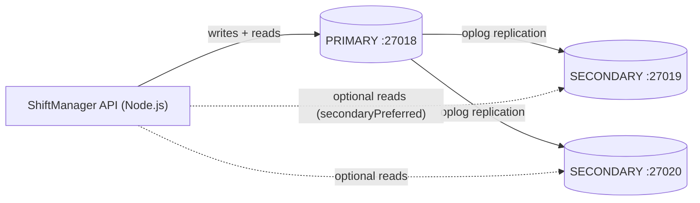

# Database Replication, Scaling and Secure Communication (bonus features)

The brief offers bonus marks for **database replication and scaling**. ShiftManager provides:

1. A **3-node MongoDB replica set** (Docker) with a tested **automatic failover** demo.
2. **Cloud option:** instructions for MongoDB Atlas (a managed replica set) – no code changes needed.
3. **Application scaling:** Node.js cluster mode (one API worker per CPU core) and connection pooling.
4. **Read scaling:** optional `secondaryPreferred` reads.
5. **Secure transport:** optional HTTPS/TLS for the API.

---

## 1. What a replica set is (viva explanation)

A replica set is a group of MongoDB servers holding **copies of the same data**:

- One **PRIMARY** accepts all writes.
- **SECONDARIES** copy the primary's operation log (oplog) and apply the same changes.
- If the primary fails, the remaining members **hold an election** and promote a secondary within seconds.
  The Node.js driver detects the new primary and retries the write (`retryWrites: true`).

Benefits: **availability** (no single point of failure), **durability** (data on 3 servers) and
**read scalability** (reads can be spread across secondaries).



## 2. Local replica set with Docker (implemented and tested)

Files: `database/docker-compose.yml`, `database/setup-replica-set.ps1`, `database/replication-demo.ps1`.

```powershell
cd C:\ShiftManager_Final
docker compose -f database/docker-compose.yml up -d                      # 3 mongod containers
powershell -ExecutionPolicy Bypass -File database/setup-replica-set.ps1   # rs.initiate + status
```

Expected:

```
localhost:27018                PRIMARY
localhost:27019                SECONDARY
localhost:27020                SECONDARY
```

### Run ShiftManager on the replica set

In `backend/.env` replace `MONGO_URI` with:

```
MONGO_URI=mongodb://localhost:27018,localhost:27019,localhost:27020/shiftmanager?replicaSet=rs0
```

Then `node scripts/seed.js` (creates the manager in this database) and `npm.cmd start`.
The backend log shows `MongoDB topology: ReplicaSetWithPrimary`.
Switch back to `mongodb://127.0.0.1:27017/shiftmanager` to use your normal local database.

### Failover demonstration

```powershell
powershell -ExecutionPolicy Bypass -File database/replication-demo.ps1
```

The script (uses its own backend on port 5055):

1. Shows the replica set status.
2. Starts the API on the replica set and creates a shift through the API.
3. Reads that shift **directly from a secondary** → proves replication.
4. **Stops the primary container** (`docker stop sm-mongo1`) → a new primary is elected.
5. Creates another shift through the API → **the app keeps working** after failover.
6. Restarts the failed node → it rejoins and catches up.
7. Removes its demo data.

Recorded output: `docs/evidence/replication-failover-demo.txt`.

**Screenshots to take:** Docker Desktop showing the containers; the setup script output (PRIMARY/SECONDARY);
the demo output at steps 4–6; optionally MongoDB Compass connected to the replica set.

Stop the replica set: `docker compose -f database/docker-compose.yml down` (`-v` also deletes its data).

## 3. Cloud option – MongoDB Atlas (free M0 cluster = 3-node replica set)

1. Create a free account at https://www.mongodb.com/cloud/atlas and **Build a Database → M0 (Free)**,
   region *Sydney (ap-southeast-2)*.
2. **Database Access:** add a database user (username + strong password).
3. **Network Access:** add your current IP address (avoid 0.0.0.0/0).
4. **Connect → Drivers → Node.js**, copy the connection string and add the database name:
   ```
   MONGO_URI=mongodb+srv://<user>:<password>@<cluster>.mongodb.net/shiftmanager?retryWrites=true&w=majority
   ```
5. Put it in `backend/.env` (never commit it), run `node scripts/seed.js`, then `npm.cmd start`.
6. Atlas → your cluster → **Metrics / Overview** shows the three replica-set members (primary + 2 secondaries).
   Atlas also offers *Test Resilience → Test Primary Failover*.

**Screenshots to take (Task 04 bonus):** cluster overview with the 3 members, Network Access, Database
Access, the app running against Atlas, and Collections showing ShiftManager data.

`mongodb+srv` connections are encrypted with TLS automatically.

## 4. Application scaling

| Technique | How | File |
|---|---|---|
| **Cluster mode** | `npm.cmd run start:cluster` forks one worker per CPU core; all share port 5000; crashed workers are replaced | `backend/cluster.js` |
| **Stateless API** | JWT sessions and MongoDB storage mean any worker or server can handle any request | design |
| **Connection pooling** | `MONGO_MAX_POOL_SIZE` (default 20 per process) | `backend/config/db.js` |
| **Read scaling** | `MONGO_READ_PREFERENCE=secondaryPreferred` sends reads to secondaries | `backend/config/db.js` |
| **Compression** | gzip responses | `backend/app.js` |
| **Indexes** | `{employeeId, date}`, `{employeeId, startDate}`, unique email/endpoint | models |

Caveat: the login rate limiter uses in-memory counters per process; with many servers a shared store
(e.g. Redis) would be used – listed as future work.

## 5. Secure communication (HTTPS/TLS)

```powershell
cd C:\ShiftManager_Final\backend
npm.cmd run cert          # creates certs/localhost-key.pem + localhost-cert.pem (git-ignored)
```

Add to `backend/.env`:

```
HTTPS_KEY_FILE=certs/localhost-key.pem
HTTPS_CERT_FILE=certs/localhost-cert.pem
```

and in `frontend/.env` (create it from `.env.example`): `VITE_API_URL=https://localhost:5000/api`.
Restart both. The backend prints `Running on Port 5000 (HTTPS)`. Open https://localhost:5000/api/health
once and accept the self-signed certificate warning so the browser trusts it for the app.

- TLS 1.2+ only (`minVersion: "TLSv1.2"`); helmet adds HSTS.
- Without these settings the API uses HTTP, which browsers allow on `localhost` because it is treated as a
  secure context. In production the API would sit behind HTTPS (e.g. a cloud host with a real certificate).
- Push messages are always encrypted end to end (p256dh/auth keys) and signed with the VAPID private key.
