# ShiftManager – Employee Shift and Leave Management System

**Final Project Report**

| Item | Details |
|---|---|
| Course | IA730001 Advanced Application Development Concepts |
| Programme | Bachelor of Information Technology |
| Assessment | Final Project (80% of course grade) |
| Student | Anku Ankush – 1000128258 |
| Lecturer | «Lecturer name» |
| Submission date | 24 November 2026 |
| GitHub repository | «https://github.com/your-username/shiftmanager» |

> **Before submitting:** replace every «…» field, add the screenshots marked **[ADD SCREENSHOT]**
> (things only you can capture: your environment, Postman app, VS Code debugger, Figma, live push
> notifications), and write Section 30 in your own words. In Word: References → Table of Contents → Automatic.

---

## Table of contents

1. Executive summary
2. Introduction
3. Business problem
4. Scope and objectives
5. Requirements
6. User roles and user stories
7. Technology selection
8. Development environment
9. Configuration
10. System architecture
11. Database design
12. UML diagrams
13. Figma designs
14. Personas and storyboard
15. Frontend implementation
16. Backend implementation
17. Authentication and authorization
18. Shift CRUD
19. Leave CRUD
20. PWA and offline access
21. Push notifications
22. Security techniques
23. Design patterns and refactoring
24. Unit testing
25. Postman testing
26. Troubleshooting and debugging
27. Additional features
28. Challenges and limitations
29. Future enhancements
30. Personal reflection
31. Conclusion
32. References
33. GitHub URL
34. Declaration of AI use

Appendices A–I

---

## 1. Executive summary

ShiftManager is a responsive full-stack Progressive Web App (PWA) that replaces spreadsheets and text
messages for rostering and leave in small businesses. The frontend uses React 19 and Vite 8; the backend
is a Node.js/Express 5 REST API storing data in MongoDB through Mongoose 9.

Two complete CRUD features are delivered:

- **Shift management** – managers create, view, filter, update and delete shifts, with validation and
  automatic conflict detection; employees see only their own shifts.
- **Leave management** – employees create, view, edit and cancel pending leave requests; managers approve
  or reject them through a small state machine where decisions are final.

Security includes bcrypt password hashing, JWT authentication with a database role check on every request,
role- and ownership-based authorization, input whitelisting, NoSQL-injection filtering, helmet security
headers, a CORS whitelist and login rate limiting. The app is installable and works offline (service-worker
app-shell cache plus per-user IndexedDB data) and sends secure Web Push notifications (VAPID) when leave is
requested or decided and when shifts change. The backend was refactored into a layered architecture using
the **Repository**, **Observer** and **Strategy** patterns.

Quality evidence: **128 backend tests** (Jest + Supertest), **29 frontend tests** (Vitest), a **61-request
Postman collection** (70 assertions, 0 failures), a **68-check** live API script, a 13-step end-to-end UI
test, an offline test, and a troubleshooting log of 15 real problems.

## 2. Introduction

This report documents the requirements, design, implementation, testing and evaluation of ShiftManager.
The project started from a partially built backend (registration, login, role middleware and basic shift
routes) and was completed into a tested, documented and demonstrable PWA. Implemented functionality is
clearly separated from future work (Section 29).

## 3. Business problem

Small hospitality and retail businesses often manage rosters in spreadsheets and receive leave requests by
text, paper or social-media messages. This causes:

- inaccurate rosters and staff working from out-of-date screenshots;
- lost or delayed leave requests and no record of decisions;
- accidental double-booking of the same employee;
- changes that are not communicated, leading to missed shifts.

ShiftManager provides one secure place for managers and employees, with notifications for important changes.

## 4. Scope and objectives

**In scope:** employee self-registration; login and logout; role-based dashboards; shift CRUD with conflict
detection; leave CRUD with approval workflow; offline viewing; push notifications; automated tests;
design, testing and debugging documentation.

**Out of scope:** payroll, overnight shifts, offline editing and synchronisation, multi-site businesses,
an admin screen for promoting managers, cloud deployment.

**Objectives (all met):** two complete CRUD features · React frontend · REST API · MongoDB storage ·
secure authentication, authorization and data isolation · input validation · offline access · secure push
messaging · design patterns · automated tests · documented debugging.

## 5. Requirements

### 5.1 Functional requirements

| ID | Requirement | Status |
|---|---|---|
| F1 | Employees can register; all users can log in and log out | Implemented and tested |
| F2 | Role-based dashboards (manager statistics; employee next shift and leave) | Implemented and tested |
| F3 | Managers create, view, filter, update and delete shifts | Implemented and tested |
| F4 | Shift rules: employee exists, real date, valid times, end after start, location required, no overlaps | Implemented and tested |
| F5 | Employees view only their own shifts, including offline | Implemented and tested |
| F6 | Employees submit, view, edit and cancel pending leave | Implemented and tested |
| F7 | Managers view all leave and approve/reject; decisions are final | Implemented and tested |
| F8 | Push notifications for new leave, leave decisions and shift changes | Implemented; server logic tested automatically; live delivery demonstrated in Chrome/Edge |

### 5.2 Non-functional requirements

| ID | Requirement | How it is met |
|---|---|---|
| N1 | Security | Section 22 |
| N2 | Usability and accessibility | Visible labels, inline error text, focus rings, confirmation dialogs, loading and empty states |
| N3 | Responsive design | CSS grid layouts; tables become stacked cards under 760 px; hamburger menu |
| N4 | Offline availability | Service worker and IndexedDB (Section 20) |
| N5 | Maintainability | Layered architecture, design patterns, ESLint, automated tests |
| N6 | Performance | Compound index `{employeeId, date}`, 10 kB request limit, ≈93 kB gzipped JavaScript bundle |

## 6. User roles and user stories

| Function | Manager | Employee |
|---|---|---|
| Register | – | ✔ (public registration only creates employees) |
| Login / logout | ✔ | ✔ |
| Create / update / delete shift | ✔ | ✖ (HTTP 403) |
| View shifts | All | Own only |
| Submit / edit / cancel leave | – | ✔ own, pending only |
| View leave | All | Own only |
| Approve / reject leave | ✔ | ✖ (HTTP 403) |

| ID | As a… | I want to… | So that… | Acceptance criteria |
|---|---|---|---|---|
| US1 | employee | register and log in | I can access my information | Name, valid email, 8+ character password; account is always *employee* |
| US2 | manager | create a shift | the roster is current | Manager only; valid employee, date and times; overlapping shift rejected |
| US3 | manager | edit or delete shifts | I can respond to changes | Edit pre-fills the form; delete needs confirmation; employee notified |
| US4 | employee | see my shifts, even offline | I always know when I work | Only my shifts; saved copy shown offline with a notice |
| US5 | employee | submit, edit, cancel leave | I can plan time off | End ≥ start; new = pending; edit/cancel while pending only |
| US6 | manager | approve or reject leave | staff get a quick decision | Manager only; final; reviewer and time recorded |
| US7 | employee | be notified of decisions and shift changes | I don't miss updates | Push after decision and shift create/update/delete |
| US8 | manager | be notified of new leave | I respond promptly | Push to managers on submission |
| US9 | any user | log out | others can't see my data | Token, offline data and push subscription removed |

## 7. Technology selection

| Need | Choice | Reason |
|---|---|---|
| User interface | React 19 | Component model and hooks; course requirement |
| Build tool | Vite 8 | Fast dev server, simple production build and preview server |
| Routing | React Router 7 | Declarative routes and a protected-route wrapper |
| API | Express 5 | Minimal, middleware-based, async error support |
| Database | MongoDB + Mongoose 9 | Flexible documents, schema validation, `populate()` for relations |
| Authentication | jsonwebtoken + bcryptjs | Stateless tokens suit a PWA; industry-standard password hashing |
| Push | web-push | Implements VAPID signing and payload encryption |
| Security | helmet, cors, express-rate-limit | Small, well-known, configurable |
| Testing | Jest + Supertest, Vitest + Testing Library, Postman/Newman | Real-database API tests; fast React tests; manual API evidence |

## 8. Development environment

Windows 11, Visual Studio Code, Node.js 24.22.1, npm 11.19.1, MongoDB Community Server (Windows service)
with MongoDB Compass, Postman, Chrome DevTools and Git 2.56.

Setup commands:

```powershell
# Backend
cd C:\ShiftManager_Final\backend
npm.cmd install
Copy-Item .env.example .env        # then set JWT_SECRET and VAPID keys
npx.cmd web-push generate-vapid-keys
node scripts/seed.js               # manager account ankush12@gmail.com
npm.cmd start                      # http://localhost:5000

# Frontend
cd C:\ShiftManager_Final\frontend
npm.cmd install
npm.cmd run dev                    # http://localhost:5173
npm.cmd run build; npm.cmd run preview   # PWA build, http://localhost:4173
```

Or use the launcher: `powershell -ExecutionPolicy Bypass -File start.ps1 -Preview -Seed`.

Backend start-up output:

```
MongoDB Connected Successfully
ShiftManager Backend Running on Port 5000
[INFO] Allowed client origin(s): http://localhost:5173,http://localhost:4173
[INFO] Push delivery strategy: web-push
```

**[ADD SCREENSHOT]** VS Code explorer showing the project structure.
**[ADD SCREENSHOT]** `node -v`, `npm -v` and the MongoDB service running.
**[ADD SCREENSHOT]** Backend and frontend terminals running.
**[ADD SCREENSHOT]** MongoDB Compass showing the `shiftmanager` database and its four collections.

## 9. Configuration

| File | Purpose |
|---|---|
| `frontend/vite.config.js` | React plugin; fixed ports 5173/4173 (`strictPort`, matching the CORS whitelist); Vitest (jsdom) |
| `frontend/package.json` | Scripts `dev`, `build`, `preview`, `test`, `lint`; React, React Router |
| `frontend/.env.example` | `VITE_API_URL=http://localhost:5000/api` |
| `backend/package.json` | Scripts `start`, `dev` (nodemon), `seed`, `test`; dependencies |
| `backend/.env.example` | `MONGO_URI`, `PORT`, `JWT_SECRET`, `JWT_EXPIRES_IN`, `CLIENT_ORIGIN`, `VAPID_PUBLIC_KEY`, `VAPID_PRIVATE_KEY`, `VAPID_SUBJECT`, `MONGO_URI_TEST` |
| `backend/services/authService.js` | JWT utility (`signToken`) and bcrypt settings |
| `backend/middleware/authMiddleware.js` | JWT verification and current-role lookup |
| `frontend/public/manifest.webmanifest` | PWA name, icons, start URL, display mode, colours |
| `frontend/public/sw.js` | Service worker |
| `frontend/src/serviceWorkerRegistration.js` | Service worker registration |
| `.vscode/launch.json` | Debug configurations (backend server, Jest, Chrome) |

The real `.env` is git-ignored; only `.env.example` (no secrets) is committed.

**[ADD SCREENSHOT]** `.env.example` and `vite.config.js` open in VS Code.

## 10. System architecture

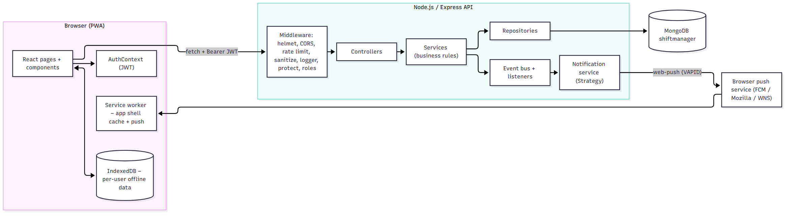

*Figure 1 – Architecture: the React PWA calls the Express API with a JWT; business events trigger Web Push through the browser push service.*

The backend is layered: **routes → middleware → controllers → services → repositories → models**.
Controllers only translate HTTP to service calls, services hold business rules, repositories hold all
MongoDB queries, and an event bus decouples notifications from the main operations.

```
backend/
├── app.js            Express app (middleware + routes) – imported by Supertest
├── server.js         Connects to MongoDB and starts listening
├── routes/           URL → middleware → controller
├── controllers/      HTTP request/response only
├── services/         Business rules, validation, conflicts, approvals, push
├── repositories/     MongoDB queries (Repository pattern)
├── events/           Event bus + notification listeners (Observer pattern)
├── middleware/       auth, roles, sanitising, logging, errors
├── models/           User, Shift, LeaveRequest, PushSubscription
└── utils/            validators, AppError, logger, asyncHandler
frontend/src/
├── api/              fetch client + API service modules
├── context/          AuthProvider / useAuth
├── hooks/            useCachedResource (offline), useOnlineStatus
├── services/         pushService
├── components/       Layout, ProtectedRoute, NotificationToggle, UI kit
├── pages/            Login, Register, Dashboard, Shifts, Leave
└── utils/            validation, IndexedDB offline store
```

## 11. Database design

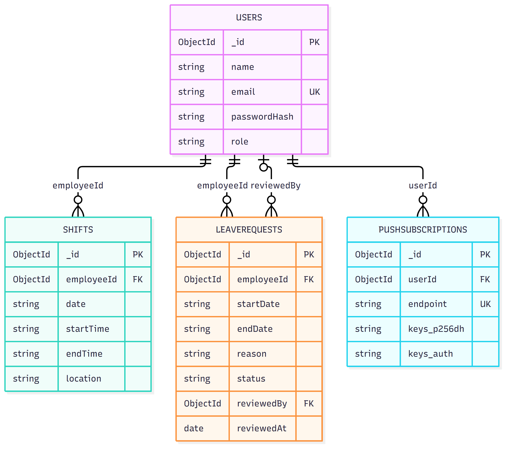

*Figure 2 – MongoDB collections and references.*

| Collection | Key fields | Indexes / rules |
|---|---|---|
| `users` | name, email, passwordHash, role | unique email; `passwordHash` has `select:false` |
| `shifts` | employeeId → users, date, startTime, endTime, location | compound `{employeeId, date}` for conflict checks |
| `leaverequests` | employeeId → users, startDate, endDate, reason, status, reviewedBy → users, reviewedAt | `{employeeId, startDate}`; status enum |
| `pushsubscriptions` | userId → users, endpoint, keys.p256dh, keys.auth | unique endpoint |

Dates are stored as `YYYY-MM-DD` strings and times as `HH:mm`. They sort correctly as text and avoid time-zone
shifts – important in New Zealand (UTC+13), where converting a local date to UTC can move it to the previous day.

## 12. UML diagrams

### 12.1 Class diagram – domain model

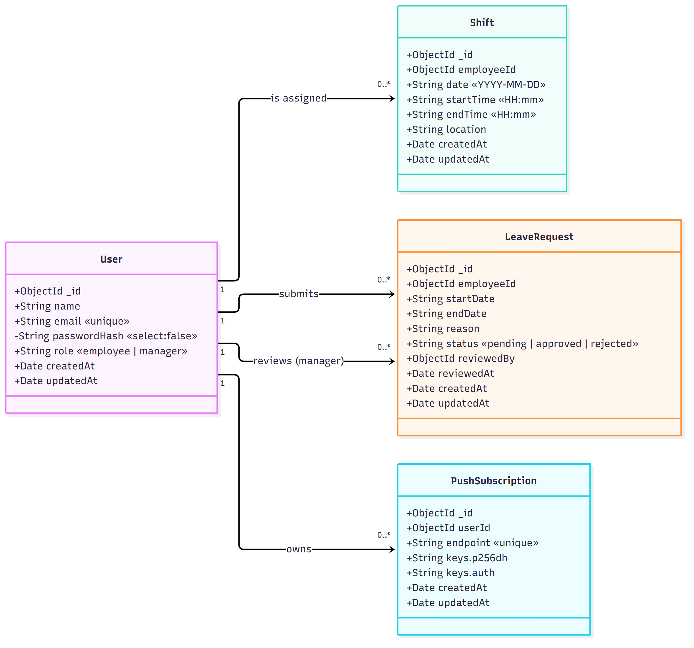

*Figure 3 – A User has many Shifts, LeaveRequests (as employee and as reviewing manager) and PushSubscriptions.*

### 12.2 Class diagram – backend layers and design patterns

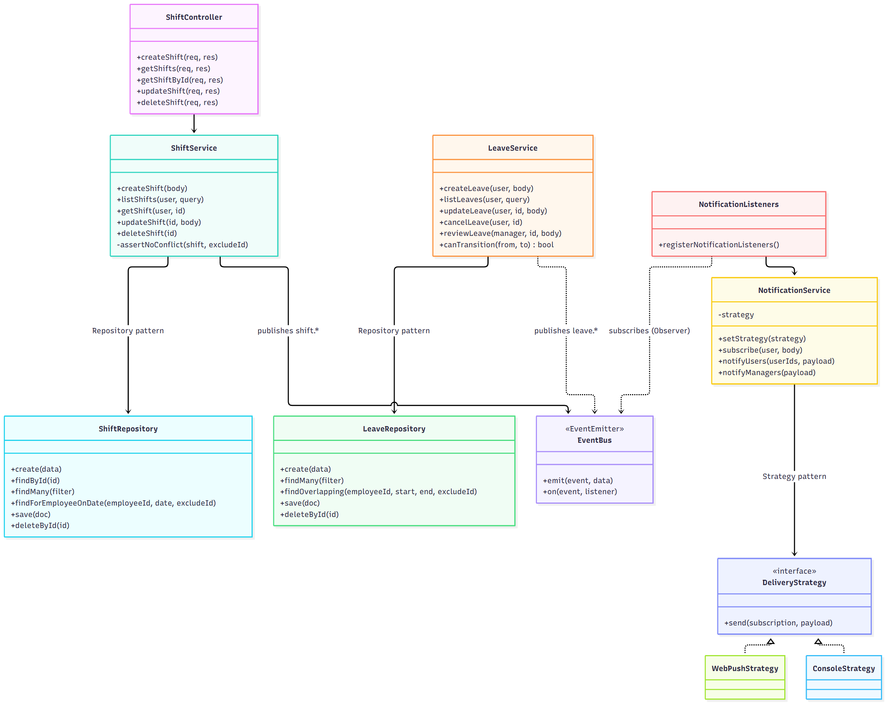

*Figure 4 – Controllers, services, repositories, the event bus and the notification strategies.*

### 12.3 Sequence diagram – login

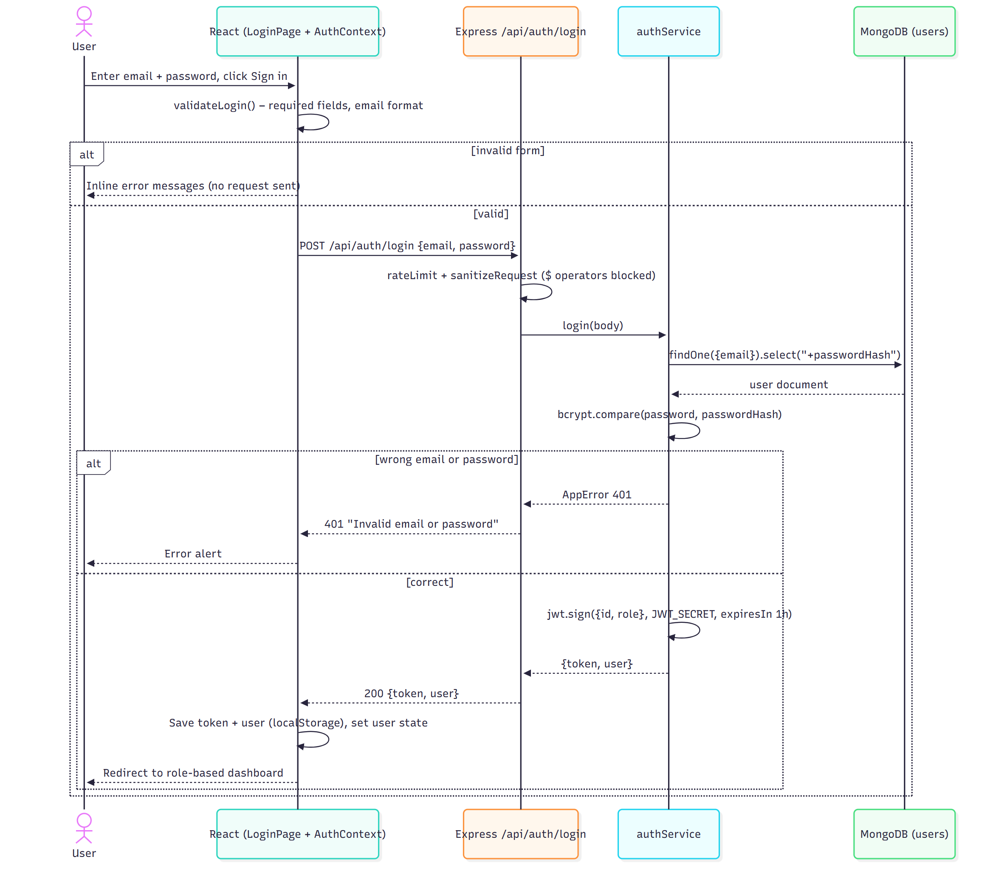

*Figure 5 – Login: client validation, rate limiting, bcrypt comparison and JWT issue.*

### 12.4 Sequence diagram – manager creates a shift

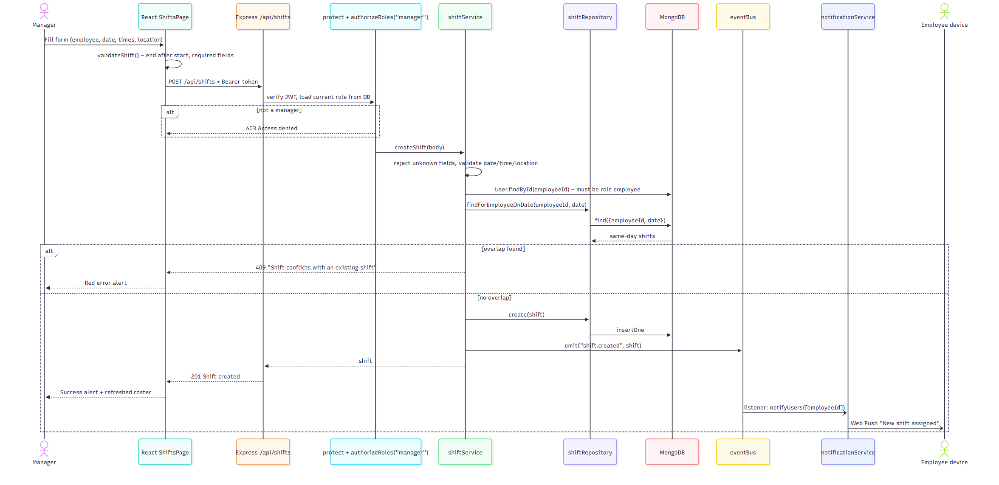

*Figure 6 – Shift creation with authorization, validation, conflict detection and an asynchronous push.*

### 12.5 Sequence diagram – employee submits leave, manager approves

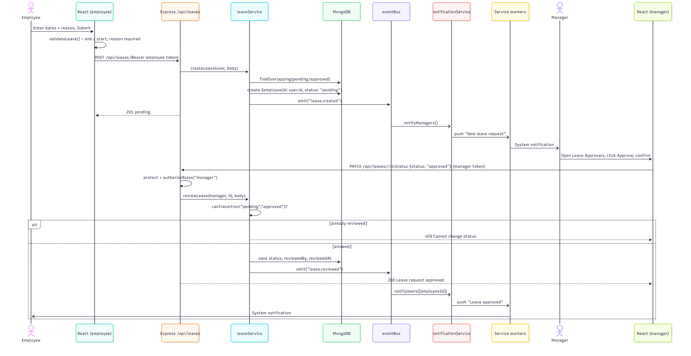

*Figure 7 – Leave submission and approval with notifications to the manager and then the employee.*

### 12.6 State diagram – leave request lifecycle

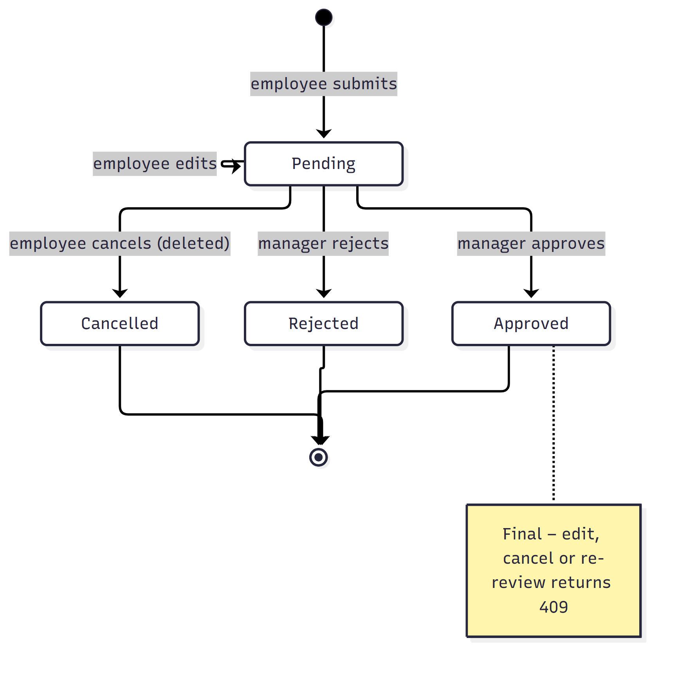

*Figure 8 – Pending requests can be edited, cancelled, approved or rejected; approved and rejected are final.*

## 13. Figma designs

The high-fidelity designs use the same design system as the implemented app: primary indigo `#4F46E5`,
navy `#1E1B4B`, success `#16A34A`, warning `#D97706`, danger `#DC2626`, background `#F5F7FB`; Inter font;
8 px spacing grid; 12 px card radius. Components: buttons (primary/success/danger/ghost), inputs with
error states, status badges, stat cards, alerts, tables, confirmation dialog and navigation bar.

**[ADD SCREENSHOT]** Figma frames: Login/Register, Manager dashboard, Employee dashboard, Shift management,
Leave management, plus mobile versions. Figma link: «URL».

## 14. Personas and storyboard

**Maria Tane – café manager (41, Hamilton).** Manages 14 casual staff. *Goals:* build the roster quickly,
avoid double-booking, decide on leave fast. *Pain points:* emailed spreadsheet versions, leave requests lost
in messages, staff missing changes. *ShiftManager helps with:* conflict detection, a live dashboard,
notifications for new leave and one-click approval.

**Ethan Liu – part-time barista (20, student).** Works around lectures and mostly uses his phone with patchy
data. *Goals:* check shifts anywhere, request exam leave, know the outcome quickly. *Pain points:* old roster
screenshots, no record of leave requests. *ShiftManager helps with:* offline roster, next-shift card,
leave history with status badges, notifications.

**Storyboard – "Ethan requests leave for exams"**

| Panel | Action | System response |
|---|---|---|
| 1 Sign in | Ethan opens the installed app on the bus | Employee dashboard with "Next shift" card |
| 2 Check shifts | No signal | Offline banner; roster from the last sync |
| 3 Submit leave | 10–12 Dec, "University exams" | "Leave request submitted"; pending badge |
| 4 Manager notified | Maria's phone: "New leave request" | Tapping opens Leave Approvals |
| 5 Approve | Maria approves and confirms | "Request approved. Ethan has been notified." |
| 6 Employee notified | Ethan: "Leave approved" | My Leave shows an approved badge |

**[ADD SCREENSHOT]** Persona cards and the illustrated storyboard (built in Figma).

## 15. Frontend implementation

The frontend is a single-page React app with routes `/login`, `/register`, `/dashboard`, `/shifts` and
`/leave`. Authenticated pages share a `Layout` (navigation, notification toggle, user chip, logout and
offline banner) and are wrapped in `ProtectedRoute`. Each page renders a manager or employee view based on
the logged-in role.

**Validation.** `src/utils/validation.js` mirrors the backend rules (required fields, email format, real
calendar dates, end time after start time, end date not before start date, length limits). Errors appear
next to each field with `aria-invalid` and `role="alert"`, and no request is sent until the form is valid.

**States.** Spinners while loading, empty-state messages, success and error alerts, confirmation dialogs
before delete/cancel/approve/reject, and buttons disabled while saving or offline.

**API integration.** `src/api/client.js` adds the `Authorization: Bearer` header, converts error responses to
an `ApiError` with status and message, treats network failures as offline (status 0), and logs the user out
automatically when the server returns 401.

| | |
|---|---|
| 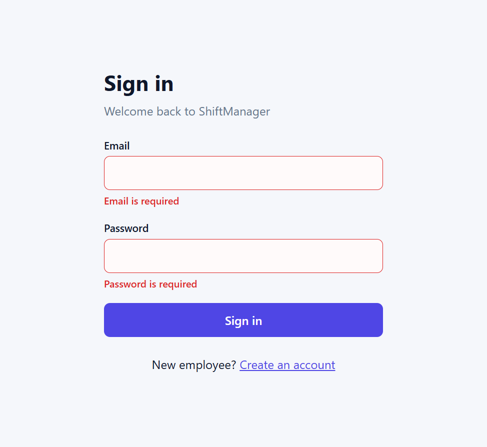 | 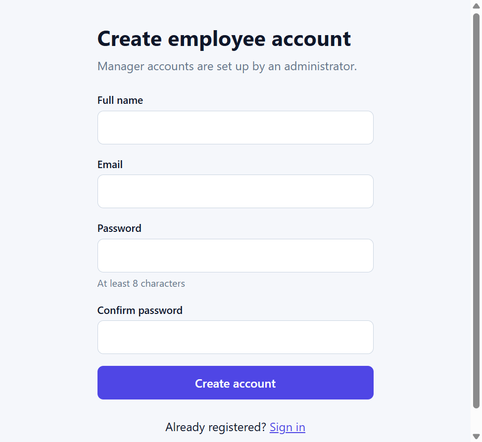 |
| *Figure 9 – Login with inline validation* | *Figure 10 – Employee registration* |
| 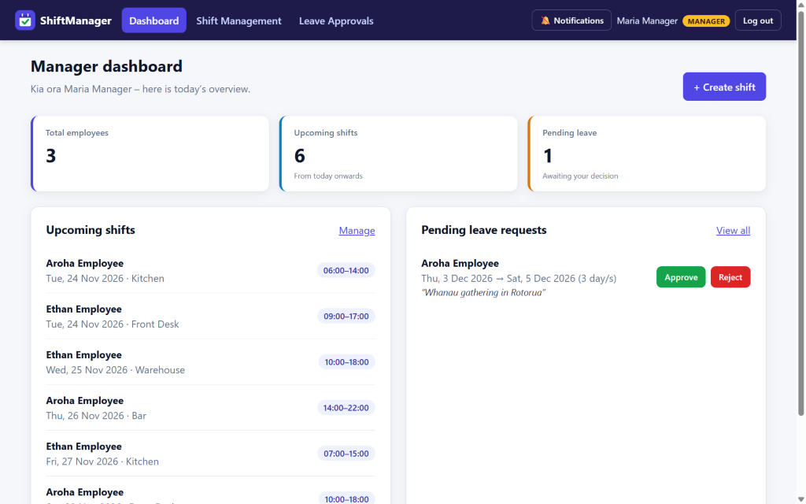 | 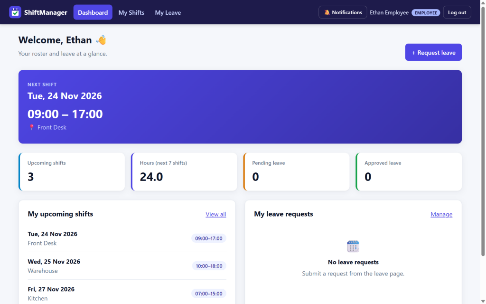 |
| *Figure 11 – Manager dashboard (live statistics)* | *Figure 12 – Employee dashboard* |
| 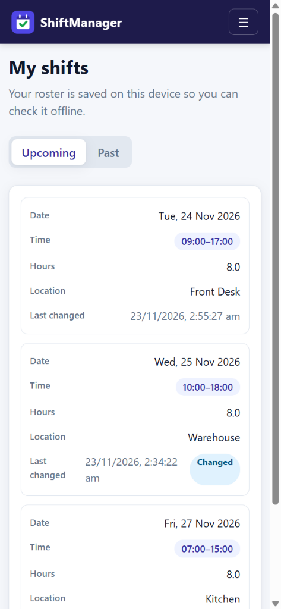 | 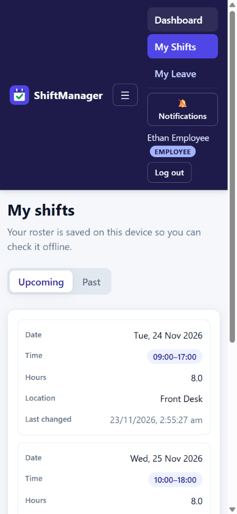 |
| *Figure 13 – Mobile layout: tables become cards* | *Figure 14 – Mobile navigation menu* |

## 16. Backend implementation

`app.js` configures global middleware in this order: `helmet()` (security headers), `cors()` (whitelisted
origins and methods), `express.json({ limit: "10kb" })`, `sanitizeRequest` (blocks `$` operators),
`requestLogger`, then mounts the routers and finally the 404 and error handlers. `server.js` checks required
environment variables, connects to MongoDB and starts the server, so tests can import `app` without
starting a server.

Controllers are short – for example:

```js
exports.updateShift = asyncHandler(async (req, res) => {
  const shift = await shiftService.updateShift(req.params.id, req.body);
  res.status(200).json({ message: "Shift updated successfully", shift });
});
```

Services throw `new AppError(message, status)`; the central error handler converts errors to safe JSON and
never sends stack traces to the client.

### API summary

| Method | Endpoint | Access |
|---|---|---|
| POST | `/api/auth/register` | Public (rate limited) |
| POST | `/api/auth/login` | Public (rate limited) |
| GET | `/api/auth/me` | Logged in |
| GET | `/api/shifts` | Manager: all (filters `from`, `to`, `employeeId`) · Employee: own |
| GET | `/api/shifts/:id` | Manager or owning employee |
| POST / PUT / DELETE | `/api/shifts`, `/api/shifts/:id` | Manager |
| GET | `/api/leaves` | Manager: all (filter `status`) · Employee: own |
| GET | `/api/leaves/:id` | Manager or owner |
| POST | `/api/leaves` | Employee |
| PUT / DELETE | `/api/leaves/:id` | Owning employee, pending only |
| PATCH | `/api/leaves/:id/status` | Manager |
| GET | `/api/notifications/public-key` | Public (VAPID public key only) |
| POST / DELETE | `/api/notifications/subscribe` | Logged in (own subscriptions) |
| POST | `/api/notifications/test` | Manager |
| GET | `/api/users/employees`, `/api/users/stats` | Manager |

Status codes: 200/201 success · 400 validation · 401 authentication · 403 permission · 404 not found ·
409 conflict · 413 too large · 429 rate limited · 500 generic error.

## 17. Authentication and authorization

**Registration** accepts only `name`, `email` and `password`; any other field (for example `role`) is
rejected with 400 and the role is always set to `employee`, preventing privilege escalation. Passwords must
be at least 8 characters and are hashed with **bcrypt (cost 12)**.

**Login** compares the password with `bcrypt.compare` and returns the same "Invalid email or password"
message for unknown emails and wrong passwords, so attackers cannot discover which emails exist. On success
the server signs a JWT containing only `{ id, role }`, valid for one hour.

**The `protect` middleware** requires `Authorization: Bearer <token>`, verifies the signature and expiry
(expired tokens get "Session expired. Please login again."), and then **loads the user from MongoDB** so the
*current* role is used. A token issued before a role change, or for a deleted user, cannot be misused.

**Authorization** uses `authorizeRoles("manager")` / `authorizeRoles("employee")` on routes (403 otherwise),
plus ownership checks in the services: employees' list queries are always filtered by their own ID (an
`employeeId` query parameter is ignored), and single-record reads or edits of another employee's data return 403.

**Frontend.** `AuthProvider` stores the token and user in `localStorage`, `ProtectedRoute` redirects anonymous
users, and logout removes the token, the user's offline data and their push subscription.

## 18. Shift CRUD

| Rule | Behaviour |
|---|---|
| Employee | Valid ObjectId of an existing user with role `employee` (400 / 404) |
| Date | Real calendar date `YYYY-MM-DD` – 2026-02-30 is rejected (400) |
| Times | 24-hour `HH:mm`; end must be after start (400) |
| Overnight policy | Not supported – an overnight shift is entered as two shifts |
| Location | Required, trimmed, at most 100 characters |
| Conflicts | Same employee, same date, overlapping times → 409; back-to-back allowed; a shift never conflicts with itself when updated |
| Unknown fields / empty update | 400 |

Updates merge the provided fields into the stored shift, then re-check the times and conflicts on the
merged result, so a partial update cannot create an invalid shift.

| | |
|---|---|
| 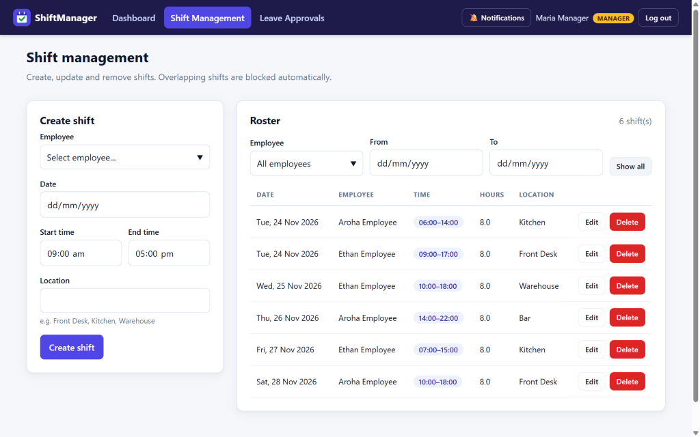 | 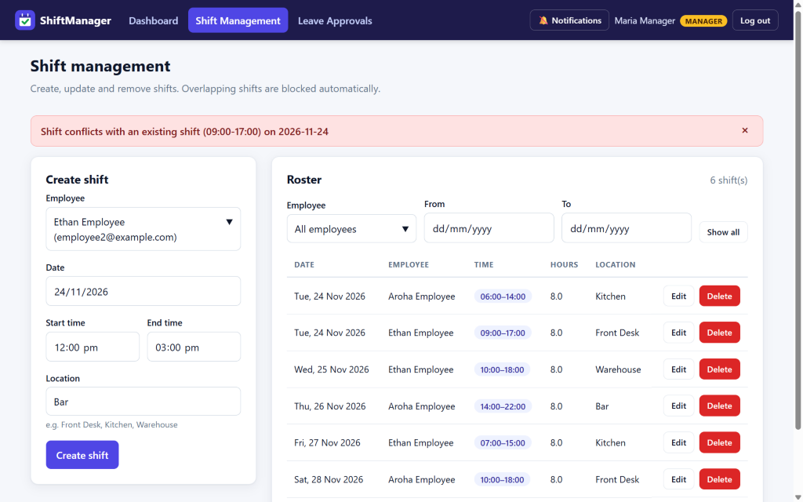 |
| *Figure 15 – Shift management form, filters and roster* | *Figure 16 – Overlapping shift rejected (HTTP 409)* |
| 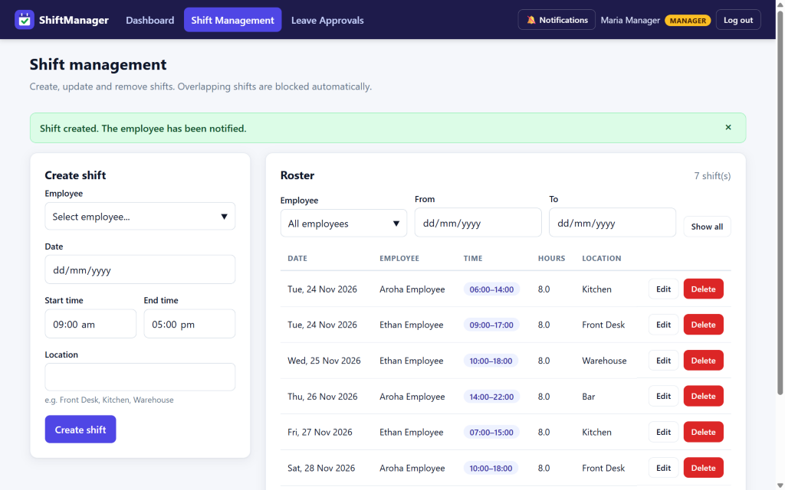 | 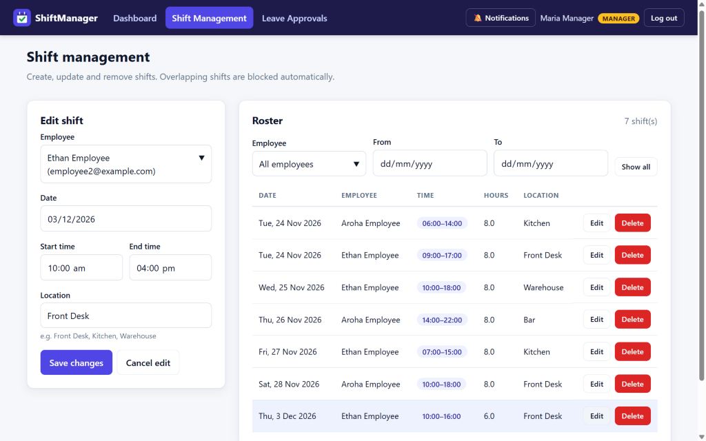 |
| *Figure 17 – Shift created* | *Figure 18 – Editing a shift* |
| 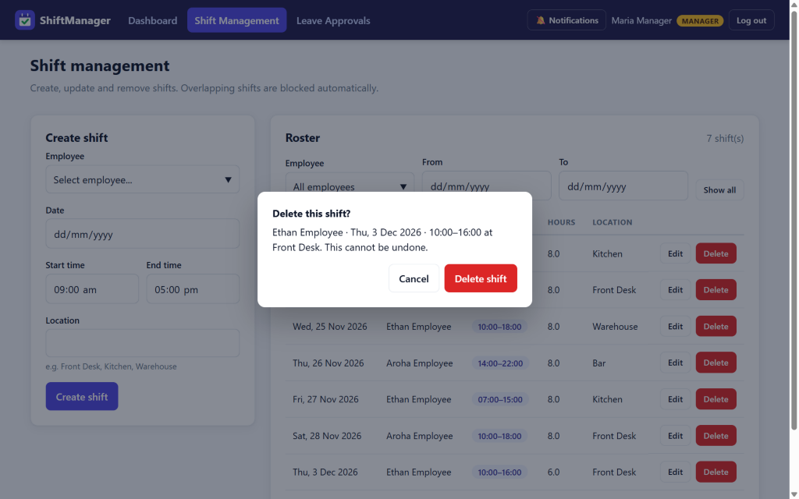 | 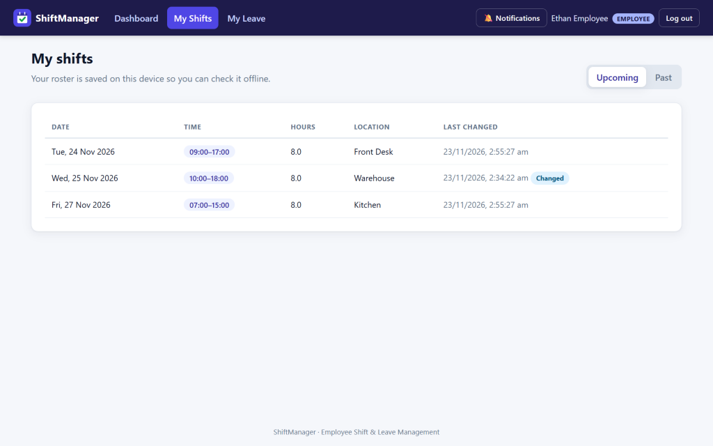 |
| *Figure 19 – Confirmation before deletion* | *Figure 20 – Employee's read-only roster* |

## 19. Leave CRUD

- The owner is always the logged-in employee – sending `employeeId` or `status` returns 400.
- Dates must be real; the end date cannot be before the start date; the reason is required (≤ 500 characters).
- Overlapping pending/approved leave for the same employee → 409.
- Employees can edit or cancel only **pending** requests (409 otherwise).
- Managers change the status with `PATCH /api/leaves/:id/status`. Allowed transitions: `pending → approved`
  and `pending → rejected`; anything else returns 409. The reviewer and review time are recorded.

| | |
|---|---|
| 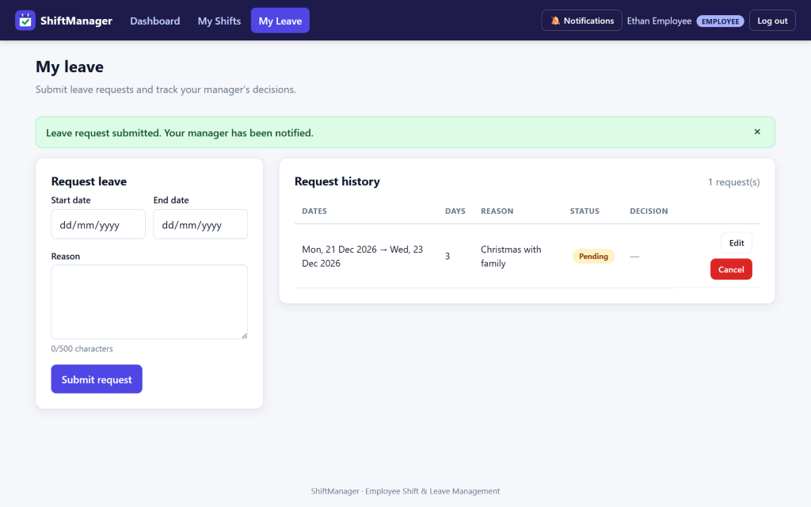 | 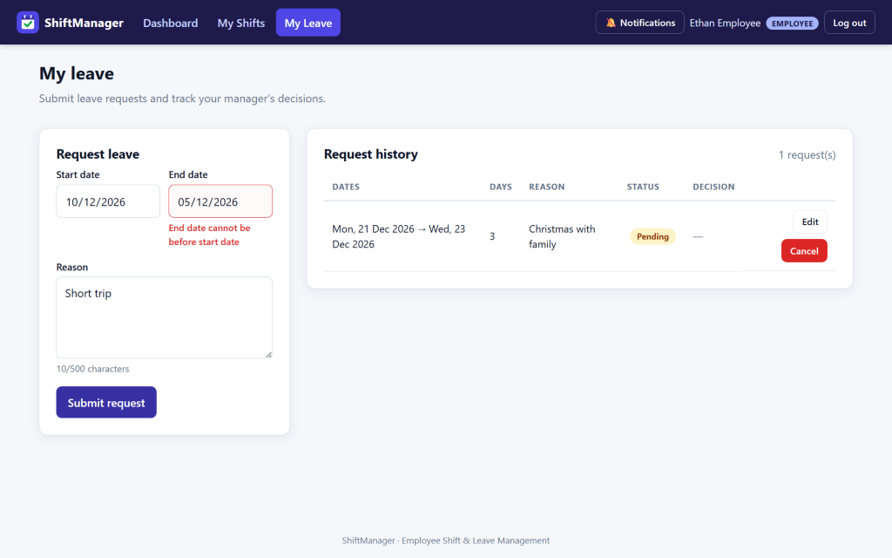 |
| *Figure 21 – Employee leave request submitted (pending)* | *Figure 22 – Date range validation* |
| 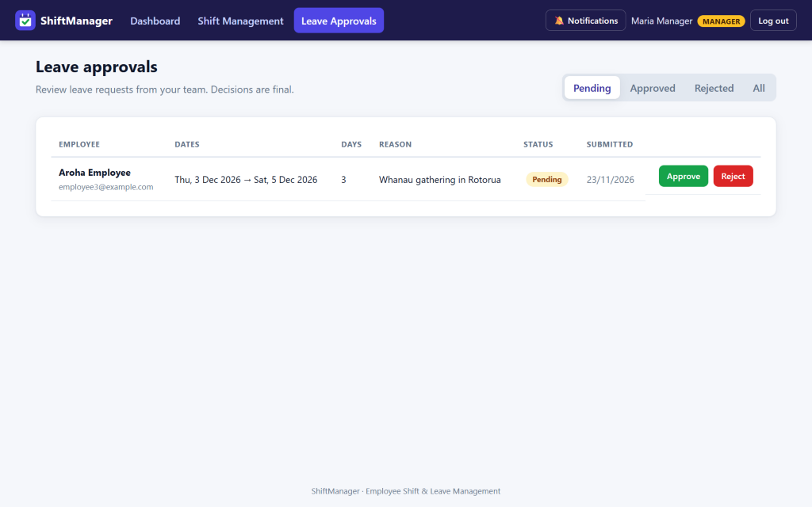 | 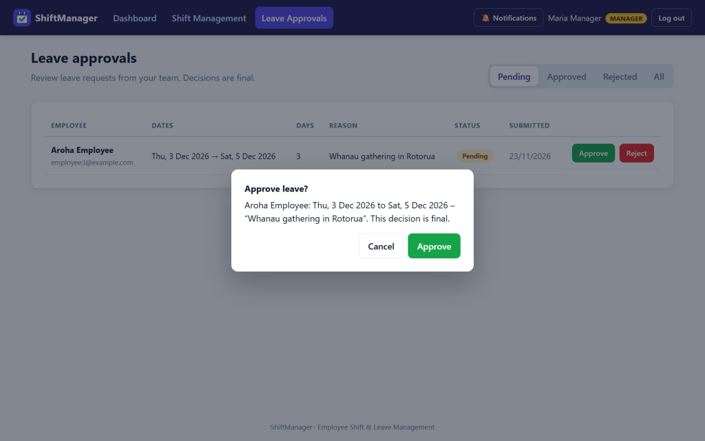 |
| *Figure 23 – Manager leave approvals* | *Figure 24 – Approval confirmation* |

## 20. PWA and offline access

| Part | Implementation |
|---|---|
| Manifest | Name, short name, 192/512 px icons (incl. maskable), `start_url: /dashboard`, `display: standalone`, theme `#4f46e5` |
| Registration | `serviceWorkerRegistration.js` registers `/sw.js` on page load |
| Install | Pre-caches the app shell (`/`, `index.html`, manifest, icons) into `shiftmanager-shell-v1` |
| Activate | Deletes older `shiftmanager-*` caches (cache versioning) and claims open pages |
| Fetch | **Network-first** for same-origin GET requests; falls back to the cache; navigations fall back to `index.html` |
| API data | Not cached by the service worker. The app saves what it needs to **IndexedDB per user** (`<userId>:<name>`) and deletes it at logout |
| UI | Offline banner, "Offline mode – showing data saved on …" notice, edit controls disabled, automatic refresh on reconnect |

Network-first was chosen because rosters change often – stale screens are worse than a slightly slower load.

**Offline test (production build).** After signing in and visiting the pages, *both* the frontend server and
the API were stopped and the page was reloaded. The service worker served the app, the API call failed with
`ERR_CONNECTION_REFUSED`, and the cached shifts were shown with the offline notice. After restarting the
servers, one reload showed live data again.

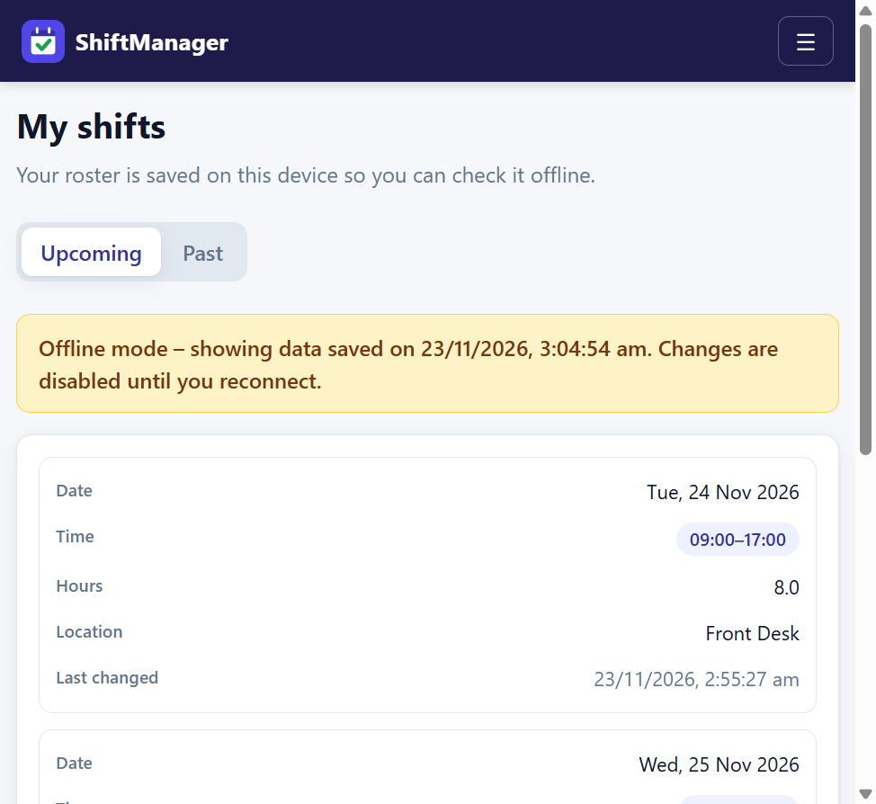

*Figure 25 – Roster shown from the offline cache with both servers stopped.*

**[ADD SCREENSHOT]** Chrome DevTools → Application: Manifest, Service workers (activated), Cache storage
(`shiftmanager-shell-v1`) and IndexedDB (`shiftmanager-offline`).
**[ADD SCREENSHOT]** Network tab set to *Offline* with the app still working, then back online.

## 21. Push notifications

**Configuration.** VAPID keys were generated with `web-push` and stored in `backend/.env`. Only the public key
is exposed (`GET /api/notifications/public-key`); the private key never leaves the server.

**Client.** `pushService.enablePush()` asks for permission, subscribes with
`pushManager.subscribe({ userVisibleOnly: true, applicationServerKey })` and posts the subscription
(endpoint and keys) to the API. The service worker's `push` handler shows the notification and
`notificationclick` opens the related page.

**Server.** Subscriptions are stored against the authenticated user (the endpoint must be an HTTPS URL with
both keys). Services publish events; listeners send notifications:

| Event | Recipient | Notification |
|---|---|---|
| Employee submits leave | All managers | "New leave request" |
| Manager approves/rejects | The employee | "Leave approved" / "Leave rejected" |
| Shift created / updated / deleted | The employee (and previous employee if reassigned) | "New shift assigned" / "Shift updated" / "Shift cancelled" |

Subscriptions that the push service reports as expired (404/410) are deleted automatically. Push failures
are logged and never break the main request.

**Testing.** Automated tests inject a fake delivery strategy and prove each scenario notifies exactly the
right user, that invalid subscriptions are rejected, that expired ones are removed, and that employees
cannot trigger notifications (403). Live delivery is demonstrated in Chrome/Edge with two browser profiles.

**[ADD SCREENSHOT]** Permission prompt and the three notifications (New leave request, Leave approved,
Shift updated), the backend log line `Push "Leave approved" -> users=1 sent=1 failed=0`, and the
`pushsubscriptions` collection in Compass.

## 22. Security techniques

| Area | Measures |
|---|---|
| Passwords | bcrypt cost 12; hash never returned (`select:false` + `toJSON` transform) |
| Sessions | JWT with 1-hour expiry; secret in `.env`; automatic logout on 401 |
| Authorization | Role middleware; current role read from MongoDB; ownership checks; employee filters enforced on the server |
| Privilege escalation | Registration whitelist; `role` field rejected |
| Input validation | Type, format, real-date and length checks; unknown fields rejected; ObjectId validation |
| NoSQL injection | Requests containing `$` or `.` keys rejected (400); queries built only from validated values |
| HTTP | helmet headers; CORS whitelist; 10 kB body limit; rate limiting on failed logins (429) |
| Errors | Safe messages; no stack traces to clients; details logged on the server |
| Secrets | `.env` git-ignored; VAPID private key server-only |
| Browser | Service worker never caches API responses; offline data per user and wiped at logout; push unsubscribed at logout |
| Transport | Optional **HTTPS/TLS** API (`npm run cert` + `HTTPS_KEY_FILE`/`HTTPS_CERT_FILE`); TLS 1.2 minimum; HSTS header |

**Secure communication.** When the certificate settings are present, `server.js` starts an HTTPS server.
Verified result: `GET https://localhost:5443/api/health → 200 | TLSv1.3 | TLS_AES_256_GCM_SHA384`, header
`Strict-Transport-Security: max-age=31536000; includeSubDomains`, and plain HTTP to the TLS port is rejected.
For everyday development the API runs on `http://localhost`, which browsers treat as a secure context; a
production deployment would use a CA-signed certificate. Push payloads are always encrypted end to end.

**Trade-off:** the JWT is kept in `localStorage` so the app can start offline. JavaScript can read it, so an
XSS bug could expose it. Mitigations: React escapes output (no `dangerouslySetInnerHTML`), tokens expire after
one hour, and the role is re-checked on the server. An httpOnly refresh cookie is listed as future work.

**Security tests (all automated and passing):** invalid login 401; missing/invalid/expired token 401; stale
"manager" role in a valid employee token 403; deleted user 401; `role:"manager"` at registration 400; NoSQL
injection 400; employee create/update/delete shift 403 (database unchanged); reading another employee's shift
or leave 403; widening the filter with `?employeeId=` ignored; employee approving leave 403; spoofed leave
owner 400; invalid ID 400; invalid status transition 409; unauthorized push trigger 403; malformed JSON 400.

## 23. Design patterns and refactoring

**Original problem.** All logic lived in the route files: the PUT route (~100 lines) validated input, queried
MongoDB, applied business rules and formatted responses; regular expressions were copied between POST and
PUT; every route repeated `try/catch`; and `server.js` both built and started the app, so it could not be
tested with Supertest. There was no overlap check and impossible dates such as 2026-02-30 were accepted.

**Refactoring.** The code was split into layers and three patterns were applied:

| Pattern | Where | How it works | Benefit |
|---|---|---|---|
| **Repository** | `backend/repositories/*` | Services call methods such as `shiftRepository.findForEmployeeOnDate()` instead of Mongoose directly | Business logic reads clearly; query details (populate, sort, indexes) change in one place |
| **Observer** | `events/eventBus.js`, `events/notificationListeners.js` | Services `emit("leave.reviewed")`; listeners subscribed at start-up send push notifications | Services have no push code; failures don't affect requests; new listeners (audit, email) need no service changes |
| **Strategy** | `services/notificationStrategies.js` | `WebPushStrategy`, `ConsoleStrategy` and a test fake share `send(subscription, payload)` | Delivery can be swapped; tests run without real push services |

Supporting techniques: middleware chain (`protect → authorizeRoles → controller`), higher-order functions
(`authorizeRoles(...)`, `asyncHandler`), a central error handler with `AppError`, a leave state machine
(`canTransition`), and on the frontend React Context (`useAuth`), a reusable offline hook
(`useCachedResource`) and an API service layer.

**Behaviour preserved.** The original Step 9.6.2 checks (create, list, update, employee 403, invalid ID,
end-before-start) were re-run after refactoring as part of the 68-check API script and the 128 automated tests.

**Quality attributes.**

| Attribute | How it is achieved |
|---|---|
| Modifiability | Layers + Repository: database changes stay in repositories; validators shared by create and update |
| Extensibility | Observer: new listeners (audit log, email) without editing services; Strategy: new delivery channels |
| Scalability | Stateless API + cluster mode; connection pooling; replica-set reads; Atlas-ready |
| Performance | Indexes, gzip compression, 10 kB body limit, service-worker caching, small bundle |
| Availability | Replica-set failover; cluster restarts crashed workers; offline PWA; push failures isolated |
| Security | Section 22 |

## 24. Unit testing

| Suite | Tool | Tests | Result |
|---|---|---|---|
| Backend unit (validators, bcrypt, JWT, role middleware, injection detection, leave transitions) | Jest | 51 | Pass |
| Backend integration (auth, shifts, leave, notifications – real Express app + separate `shiftmanager_test` database) | Jest + Supertest | 77 | Pass |
| Frontend (form validation, API client, Login page, ProtectedRoute, UI components) | Vitest + Testing Library | 29 | Pass |

Assertions check status codes, response structure **and the database state** – for example that a shift is
unchanged after an employee's 403 update attempt, or that approval stores the reviewer and time.

```
PASS tests/integration/auth.test.js
PASS tests/integration/shifts.test.js
PASS tests/integration/leaves.test.js
PASS tests/integration/notifications.test.js
PASS tests/unit/middlewareAndRules.test.js
PASS tests/unit/validators.test.js
Test Suites: 6 passed, 6 total
Tests:       128 passed, 128 total
```

```
✓ src/test/apiClient.test.js (5 tests)
✓ src/test/validation.test.js (15 tests)
✓ src/test/components.test.jsx (9 tests)
Test Files  3 passed (3)
     Tests  29 passed (29)
```

**[ADD SCREENSHOT]** Both test runs in the VS Code terminal.

## 25. Postman testing

The collection `postman/ShiftManager.postman_collection.json` has 61 requests in five folders (Auth, Shifts,
Leave, Notifications, Users). Login requests save tokens and IDs into collection variables, every request has
`pm.test` assertions, and dates use a random future year so the collection can be re-run. A headless run with
Newman gave **61 requests, 70 assertions, 0 failures**.

| # | Test | Endpoint | Expected | Actual |
|---|---|---|---|---|
| A6 | Register with `role: "manager"` | POST /auth/register | 400 | 400 ✅ |
| A7 | Wrong password | POST /auth/login | 401 | 401 ✅ |
| A8 | NoSQL injection | POST /auth/login | 400 | 400 ✅ |
| A9 | Missing token | GET /protected | 401 | 401 ✅ |
| S1 | Manager creates shift | POST /shifts | 201 | 201 ✅ |
| S2 | Overlapping shift | POST /shifts | 409 | 409 ✅ |
| S4 | Invalid date 2027-02-30 | POST /shifts | 400 | 400 ✅ |
| S8 | Employee creates shift | POST /shifts | 403 | 403 ✅ |
| S10 | Employee sees only own shifts | GET /shifts | own IDs only | ✅ |
| S12 | Manager updates shift | PUT /shifts/:id | 200 | 200 ✅ |
| S13 | Employee updates shift | PUT /shifts/:id | 403 | 403 ✅ |
| S18 | Manager deletes shift | DELETE /shifts/:id | 200 | 200 ✅ |
| L1 | Employee creates leave | POST /leaves | 201 pending | 201 ✅ |
| L5 | Another employee views leave | GET /leaves/:id | 403 | 403 ✅ |
| L8 | Employee approves leave | PATCH /leaves/:id/status | 403 | 403 ✅ |
| L9 | Manager approves | PATCH /leaves/:id/status | 200 | 200 ✅ |
| L10 | Approved → rejected | PATCH /leaves/:id/status | 409 | 409 ✅ |
| N4 | Employee triggers push | POST /notifications/test | 403 | 403 ✅ |

The full 50-row test log (endpoint, input, expected, actual, pass) is in Appendix B (`docs/TESTING.md`).

**[ADD SCREENSHOT]** Postman Collection Runner with all tests green, plus individual requests showing a 201,
a 403, a 401 and a 409 response with the Test Results tab.

## 26. Troubleshooting and debugging

**Logging.** A request logger records each request (`PUT /api/shifts/… -> 200 (8ms)`), with 4xx as WARN and
5xx as ERROR; notification results are logged (`Push "Shift updated" -> users=1 sent=1 failed=0`). The
central error handler logs stack traces for 500 errors on the server only.

**Problems encountered (summary – full details in Appendix C):**

| # | Problem | Root cause | Fix |
|---|---|---|---|
| 1 | `jwt is not defined` | Missing `require("jsonwebtoken")` | Added import |
| 2 | `Identifier 'authRoutes' has already been declared` | Duplicate line in server.js | Removed duplicate |
| 3 | `Cannot find module …server.js` | File saved as `sever.js` | Renamed |
| 4 | Manager received 403 | Role was still `employee`; old token | Role set in Compass; middleware now reads the current role from the DB |
| 5 | GET shifts showed no rows (Step 9.6.2) | Collection was empty (`count: 0`), not a code bug | Inspected raw response and DB; created a shift; PUT tested |
| 6 | 12 false test failures | PowerShell variables are case-insensitive (`$E` overwrote `$e`) | Renamed variables |
| 7 | 409 on test re-run | Previous run's approved leave | Random future dates + cleanup script |
| 8 | 429 during testing | Rate limiter counted every login | Count only failed attempts |
| 9 | Jest "Must use import to load ES Module" | `web-push` v4 is ESM | Lazy-load in the real strategy only |
| 10 | Jest couldn't connect to MongoDB | Driver's dynamic `import()` blocked by Jest | `--experimental-vm-modules` |
| 11 | VAPID private key printed to a log | Generating secrets in a visible terminal | New keys written straight to `.env` |
| 12 | ESLint React-hooks errors | Ref updated during render, sync setState in effect | Refactored hook and context file |
| 13 | Port 5173 in use | Old project's server running | Stopped it / `strictPort` |
| 14 | Forms enabled while server unreachable | `navigator.onLine` was still true | Disable edits whenever cached data is shown |
| 15 | Replica set unreachable; demo hit the wrong server | `host.docker.internal` timed out; another backend was on port 5000 | Shared container network (`localhost` members); dedicated demo port; fail-fast checks |

Problem 10 shows the debugging approach: the test only reported a timeout, so a small temporary test printed
the underlying error (`Missing required sub-document 'driver' in the client metadata document`). Searching
that message identified the driver/Jest incompatibility and the fix.

**Debugger.** `.vscode/launch.json` provides "Backend: debug server". A breakpoint in
`shiftService.assertNoConflict` with watch expressions `startTime`, `endTime`, `sameDay.length` and
`sameDay.map(s => s.startTime + "-" + s.endTime)` shows the overlap being detected before the 409 response.

**[ADD SCREENSHOT]** VS Code paused at the breakpoint with the WATCH panel.
**[ADD SCREENSHOT]** Chrome DevTools breakpoint in `useCachedResource` while offline.

## 27. Additional features

### 27.1 Database replication and scaling (bonus)

A **3-node MongoDB replica set** runs in Docker (`database/docker-compose.yml`, initialised by
`database/setup-replica-set.ps1`). The backend connects with a multi-host connection string
(`…27018,…27019,…27020/shiftmanager?replicaSet=rs0`) and logs topology changes (`backend/config/db.js`).

`database/replication-demo.ps1` proved replication and failover through the real API:

```
=== 1. Replica set status ===
  localhost:27018               PRIMARY
  localhost:27019               SECONDARY
  localhost:27020               SECONDARY
=== 3. Write data through the API ===
  Created shift 6b039407e876fa3ebfabfc8a via the API (written to the PRIMARY)
=== 4. Read the same shift directly from a SECONDARY (proves replication) ===
  Found on secondary localhost:27019: Replica Test A 2099-06-01
=== 5. Simulate a failure: stop the PRIMARY container (sm-mongo1) ===
  localhost:27018               (not reachable/healthy)
  localhost:27019               PRIMARY
  localhost:27020               SECONDARY
=== 6. The API still works after failover ===
  Created shift 6b039413e876fa3ebfabfc8b after failover - written to the NEW primary
=== Backend log ===
  [WARN] MongoDB disconnected - waiting for a primary...
  [INFO] Replica set PRIMARY is now localhost:27019
  [INFO] MongoDB reconnected
```

The new primary was elected in under one second and the API kept serving requests.

**Scaling:** the API is stateless (JWT + MongoDB), so `npm run start:cluster` (`backend/cluster.js`) runs
one worker per CPU core on the same port and replaces crashed workers. Connection pooling
(`MONGO_MAX_POOL_SIZE`) and optional secondary reads (`MONGO_READ_PREFERENCE=secondaryPreferred`) are
configurable. MongoDB Atlas (a managed cloud replica set) works with only a connection-string change –
steps in `docs/DATABASE_REPLICATION.md`.

**[ADD SCREENSHOT]** Docker Desktop with the replica-set containers, and the demo output.
**[ADD SCREENSHOT – optional]** MongoDB Atlas cluster overview if you also deploy to the cloud.

### 27.2 Other extra features

- Optional **HTTPS/TLS** for the API (Section 22).
- gzip **response compression**.
- Shift conflict detection (overlaps rejected; back-to-back allowed).
- Filtering: shifts by employee and date range; leave by status tabs.
- Dashboard statistics from live database counts; employee hours for the next seven shifts.
- "Changed" badge on shifts that were modified after creation.
- Login rate limiting and helmet security headers.
- Seeding, password-reset helper, one-command launcher and submission ZIP script.
- Responsive mobile layout with stacked table cards and a hamburger menu.

## 28. Challenges and limitations

**Challenges:** toolchain incompatibilities between the newest MongoDB driver, ESM-only `web-push` and Jest;
designing offline support without caching sensitive data; distinguishing "browser online" from "server
reachable".

**Limitations:** overnight shifts are not supported (two shifts are needed); offline mode is read-only; the
JWT is stored in `localStorage`; managers are promoted outside the UI; the app runs locally over HTTP on
localhost rather than a deployed HTTPS server.

## 29. Future enhancements

httpOnly refresh tokens; an admin screen for user management; offline edits with Background Sync; a calendar
or week view with drag-and-drop rostering; overnight shifts; notification preferences; audit history;
deployment with HTTPS and a MongoDB Atlas replica set for replication and scaling.

## 30. Personal reflection

> **Write this section yourself (about 400–600 words).** Suggested prompts:
> - What was hardest, and how did you work through it?
> - Which bug taught you the most (for example the empty GET in Step 9.6.2 or the Jest connection error)?
> - How did your understanding of authentication, authorization and PWAs change?
> - What would you plan or test differently next time?
> - How did you use tools, including AI assistance, and how did you check and understand what they produced?
> - Which skills will you use in future work?

## 31. Conclusion

ShiftManager meets the project objectives. It provides two complete CRUD features backed by MongoDB, a
functional and validated React interface, secure authentication and authorization with employee data
isolation, offline access through a service worker and IndexedDB, secure Web Push messaging, clearly applied
design patterns, and an extensive automated test suite supported by Postman and end-to-end testing.

## 32. References

Express.js. (2025). *Express 5.x API reference*. https://expressjs.com/en/5x/api.html

Jones, M., Bradley, J., & Sakimura, N. (2015). *JSON Web Token (JWT)* (RFC 7519). Internet Engineering Task Force. https://datatracker.ietf.org/doc/html/rfc7519

Meta Open Source. (2025). *React documentation*. https://react.dev/

MongoDB, Inc. (2025). *MongoDB manual*. https://www.mongodb.com/docs/manual/

Mongoose. (2025). *Mongoose documentation*. https://mongoosejs.com/docs/

Mozilla. (2025). *IndexedDB API*. MDN Web Docs. https://developer.mozilla.org/en-US/docs/Web/API/IndexedDB_API

Mozilla. (2025). *Push API*. MDN Web Docs. https://developer.mozilla.org/en-US/docs/Web/API/Push_API

Mozilla. (2025). *Service Worker API*. MDN Web Docs. https://developer.mozilla.org/en-US/docs/Web/API/Service_Worker_API

OWASP Foundation. (2021). *OWASP Top 10*. https://owasp.org/Top10/

Thomson, M., & Beverloo, P. (2017). *Voluntary Application Server Identification (VAPID) for Web Push* (RFC 8292). Internet Engineering Task Force. https://datatracker.ietf.org/doc/html/rfc8292

Vite. (2025). *Vite guide*. https://vite.dev/guide/

web-push-libs. (2025). *web-push* [Computer software]. npm. https://www.npmjs.com/package/web-push

## 33. GitHub URL

«https://github.com/your-username/shiftmanager»

**[ADD SCREENSHOT]** The GitHub repository page showing the code and commit history.

## 34. Declaration of AI use

> **Complete this section honestly (required by the course's "Responsible Use of AI" rules).** The brief
> asks students to disclose AI assistance and not to submit AI-generated code or content as their own original
> work. Describe, in your own words:
> - which AI tools you used and for what (e.g. explaining concepts, debugging, generating or refactoring code,
>   drafting documentation, generating screenshots/diagrams);
> - which parts of the code and report were produced or substantially changed with AI help;
> - how you checked, tested and understood that work;
> - which parts are entirely your own work (including the reflection).
>
> Discuss this with your lecturer before submitting if you are unsure what is acceptable.

---

## Appendices

- **Appendix A – API reference:** `docs/API.md`
- **Appendix B – Full test log:** `docs/TESTING.md`; raw outputs in `docs/evidence/`
- **Appendix C – Troubleshooting log:** `docs/TROUBLESHOOTING.md`
- **Appendix D – Security details:** `docs/SECURITY.md`
- **Appendix E – Design patterns with code:** `docs/DESIGN_PATTERNS.md`
- **Appendix F – PWA and push demo scripts:** `docs/PWA_AND_PUSH.md`
- **Appendix G – Personas, user stories, storyboard:** `docs/PERSONAS_STORYBOARD.md`
- **Appendix H – Figma design specification:** `docs/FIGMA_GUIDE.md`
- **Appendix I – Replication, scaling and HTTPS:** `docs/DATABASE_REPLICATION.md`; `docs/evidence/replication-failover-demo.txt`; `docs/evidence/https-tls-check.txt`

### Screenshot checklist

- [x] Working application screenshots (Figures 9–25)
- [x] UML class, sequence, state and ER diagrams (Figures 1–8)
- [ ] VS Code project structure and environment setup
- [ ] MongoDB connection and collections
- [ ] Configuration files
- [ ] Postman runner and individual requests
- [ ] DevTools: manifest, service worker, cache storage, IndexedDB, offline toggle
- [ ] Live push notifications
- [ ] Automated tests in the terminal
- [ ] Debugger breakpoints and watches
- [ ] Figma frames, persona cards, storyboard
- [ ] GitHub repository
