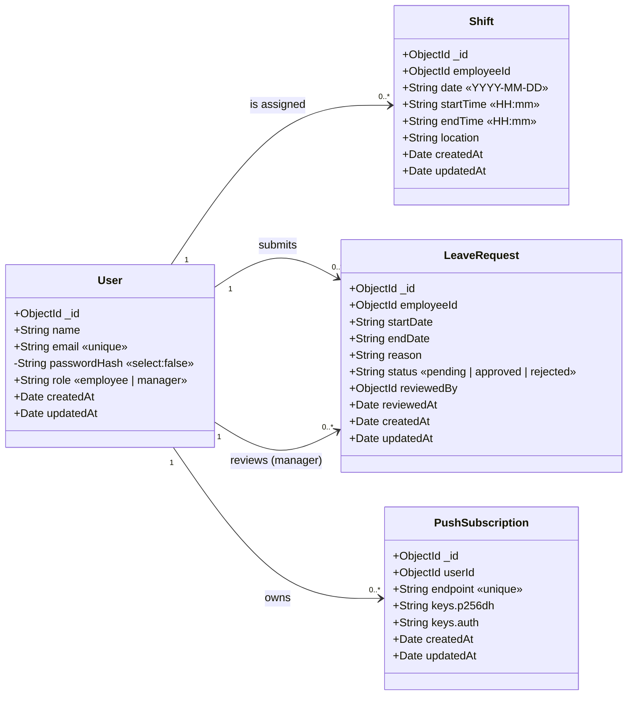
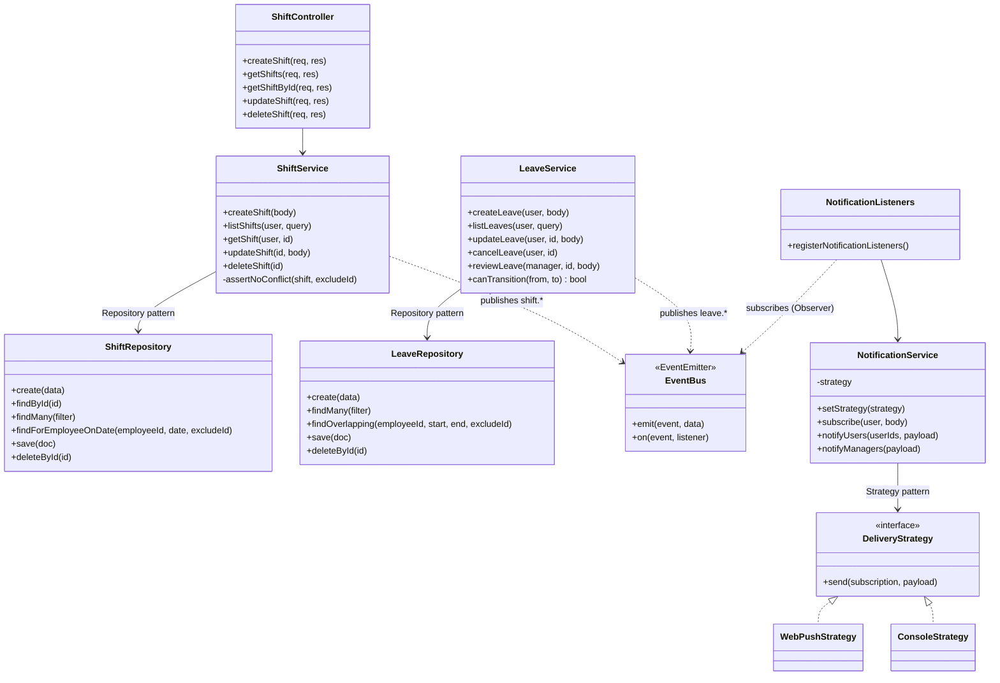
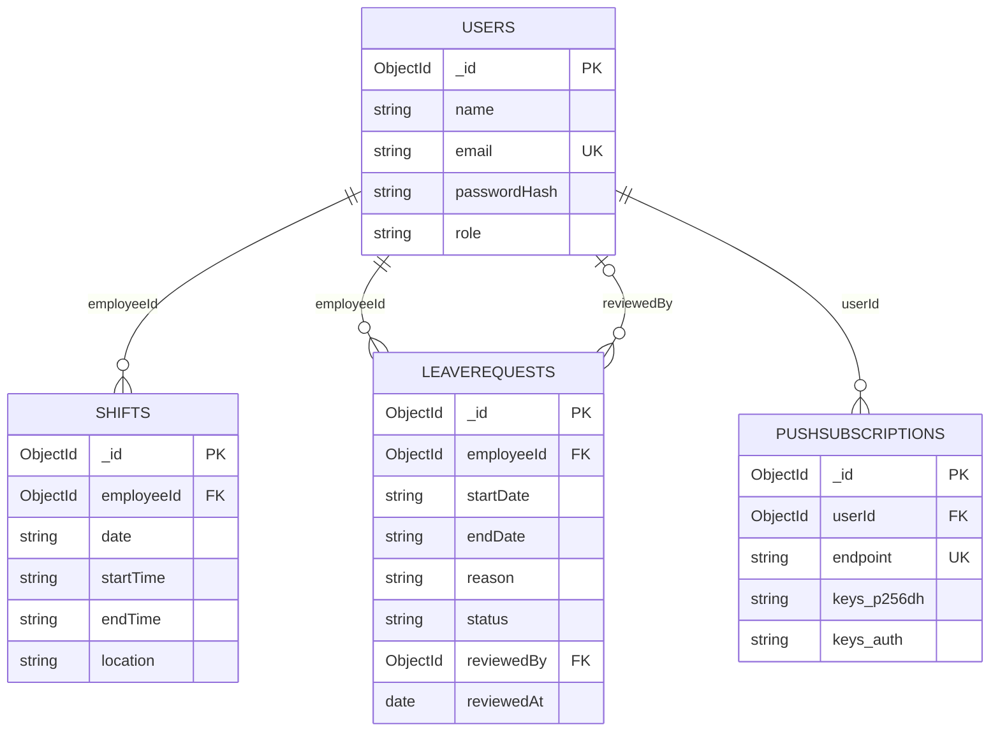
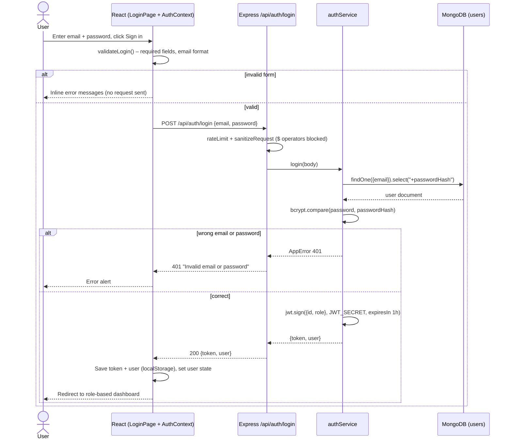
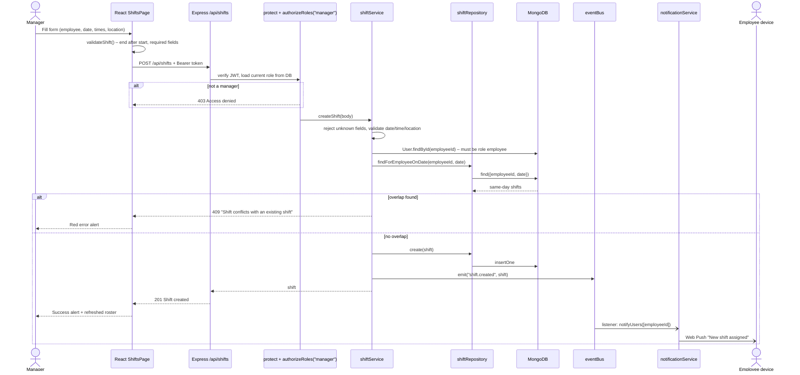
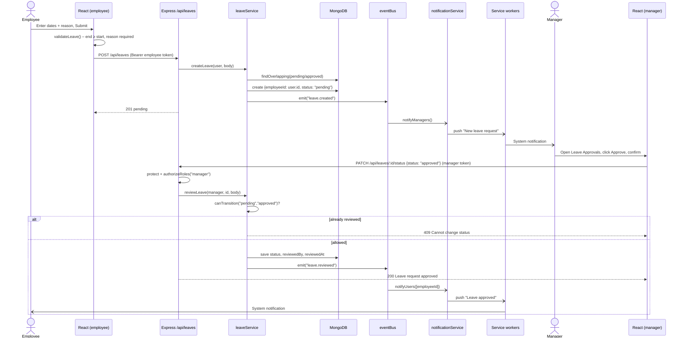
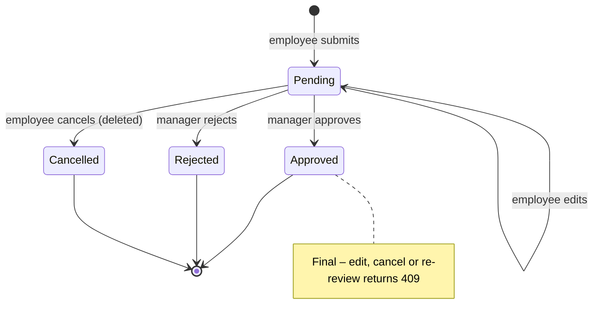
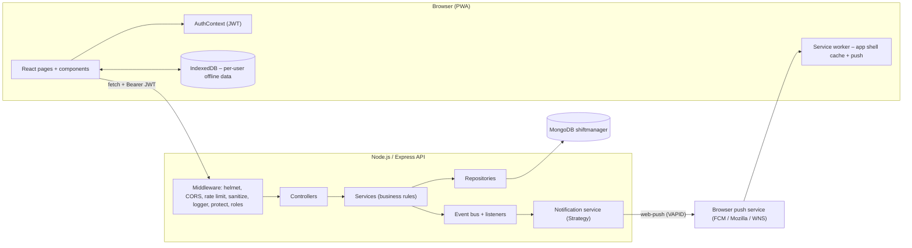

# ShiftManager – UML and Architecture Diagrams

> These diagrams are written in Mermaid. They render in VS Code (Markdown Preview Mermaid extension),
> GitHub, or at https://mermaid.live where you can export PNG/SVG for the Design Report.

## 1. UML class diagram (domain model)

## 2. UML class diagram (backend layers and design patterns)

## 3. Entity-relationship diagram (MongoDB collections)

## 4. Sequence diagram – Login

## 5. Sequence diagram – Manager creates a shift

## 6. Sequence diagram – Employee submits leave, manager approves

## 7. State diagram – Leave request lifecycle

## 8. Architecture overview

